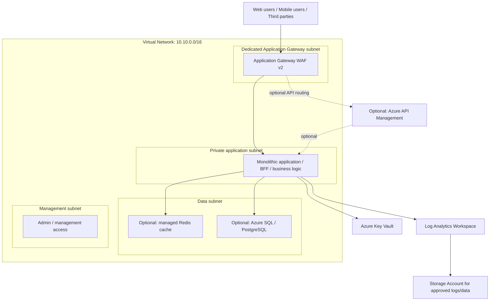

# Monolithic Infra Landing Zone
## Centralized Monolithic Application Platform — Microsoft Azure

**Author:** Pradip Gavhankar  
**Infrastructure as Code:** Terraform  
**Cloud:** Microsoft Azure  
**Design:** Single Terraform root module with resource definitions split into focused `.tf` files

> **Important:** Review Azure region/SKU availability, subscription permissions, network overlaps, and estimated cost before running `terraform apply`. The Terraform configuration deploys a private Linux VM backend and a WAF_v2 Application Gateway.

---

## 1. उद्देश्य | Purpose

यह प्रोजेक्ट Azure पर एक centralized monolithic application platform की infrastructure foundation बनाने के लिए है। इसमें एक ही application platform और Terraform root configuration होती है, लेकिन code को अलग-अलग `.tf` files में रखा जाता है ताकि समझना, maintain करना और troubleshoot करना आसान हो।

This project describes a centralized Azure foundation for a monolithic application. “Monolithic” describes the application/deployment architecture; splitting Terraform resources into multiple `.tf` files does **not** make the application microservices-based. All files in one directory are evaluated as one Terraform root module and normally share one state.

### Goals

- Create a Resource Group and Virtual Network.
- Separate front-end, application, data, and management network tiers.
- Apply Network Security Groups (NSGs) and least-privilege access principles.
- Add Key Vault, Log Analytics, and a Storage Account foundation.
- Keep HLD, LLD, Terraform code, and screenshot evidence organized separately.
- Support safe planning, cost review, deployment, troubleshooting, and cleanup.

---

## 2. Hindi mein simple explanation

मान लो हमारी application एक बड़ी company application है। इसमें web/mobile users, business logic, database और cache जैसे parts हैं। Application monolithic हो सकती है, लेकिन network को अलग-अलग tiers में बाँटने से security और operations बेहतर तरीके से manage किए जा सकते हैं।

- **Frontend tier:** Users का HTTPS traffic WAF_v2 Application Gateway receive करता है; HTTP requests HTTPS पर redirect होती हैं।
- **Application tier:** Private Linux VM पर sample Nginx backend host होता है; inbound HTTP केवल Application Gateway subnet से allow है।
- **Data tier:** Database और cache के लिए isolated network boundary रखी जाती है।
- **Management tier:** Administrative access, monitoring और operational tools के लिए।
- **Security:** NSG, Key Vault, Azure RBAC, managed identities और private connectivity.
- **Monitoring:** Log Analytics और resource diagnostic settings.

**ध्यान दें:** यह एक hardened sample Linux VM deploy करता है, पूर्ण monolithic application नहीं। Database और Redis के लिए अलग Azure resources, private networking, DNS और configuration चाहिए।

## 3. English explanation

A monolithic application packages much of its business functionality into one deployable application. This landing zone includes a private Ubuntu Linux VM backend, an HTTPS-only WAF_v2 Application Gateway, segmented networking, Key Vault, Log Analytics, and storage. The VM runs a sample Nginx health page; replace it with your application deployment.

---

## 4. High-Level Design (HLD)



**Diagram notes**
- This is a logical HLD, not proof that all optional resources exist.
- A subnet is a network segment, not an application or database service.
- Application Gateway WAF and Azure API Management solve different problems. Application Gateway is primarily application delivery/reverse proxy/WAF; API Management provides API publishing, policies, subscriptions, and API lifecycle capabilities. They can be used together when the design requires both.
- Use private endpoints and private DNS for supported PaaS services where appropriate. Validate name resolution and connectivity end-to-end.

### Architecture mapping: diagram → Azure

| Diagram component | Azure implementation | Status in a foundation-only deployment |
|---|---|---|
| VPC | Virtual Network + subnets | Included when Terraform resources are configured |
| Front-end access / WAF | Application Gateway WAF v2 + dedicated subnet | Included; HTTPS requires a Key Vault PFX secret |
| API gateway | Azure API Management, or Application Gateway for a different ingress use case | Optional; not interchangeable in every scenario |
| Application logic | Private Ubuntu Linux VM in the application subnet | Included with sample Nginx backend |
| Shared database | Azure SQL / Azure Database for PostgreSQL + private endpoint/DNS where selected | Optional |
| Cache | Azure Managed Redis / supported cache service | Optional; separate service and cost |
| Security and management | NSGs, Key Vault, Application Gateway managed identity | Included; VM has no public IP and no inbound SSH |
| Monitoring and logging | Log Analytics + Azure Monitor diagnostic settings/alerts | Workspace alone does not automatically collect every resource log |
| Diagnostics storage | Storage Account with appropriate lifecycle/access controls | Foundation; configure diagnostic destinations explicitly |

---

## 5. What will be created?

The exact resources created are determined by the `.tf` files in your project—not by this README alone.

| Layer | Resource | Purpose |
|---|---|---|
| Foundation | Resource Group | Container for project resources |
| Networking | Virtual Network `10.10.0.0/16` | Private network boundary |
| Networking | `frontend-snet` — `10.10.1.0/24` | Intended for front-end ingress components |
| Networking | `application-snet` — `10.10.2.0/24` | Intended for application workloads |
| Networking | `data-snet` — `10.10.3.0/24` | Intended for database/cache connectivity where supported |
| Networking | `management-snet` — `10.10.4.0/24` | Intended for management services |
| Security | NSGs and associations | Traffic filtering at supported subnet/NIC boundaries |
| Security | Key Vault | Secrets and key management; access policy/RBAC must be configured |
| Monitoring | Log Analytics Workspace | Central log and query destination |
| Storage | Storage Account | Approved diagnostics/general storage use |
| Optional | Application Gateway WAF | Web ingress and WAF |
| Optional | API Management | API gateway and policy layer |
| Optional | Azure SQL / PostgreSQL | Managed relational database |
| Optional | Managed Redis service | Cache layer |
| Optional | App Service / VM / Container Apps / AKS | Application compute |

**Do not claim that optional resources are deployed unless the Terraform code contains their resource blocks and the deployment has succeeded.**

---

## 6. Low-Level Design (LLD)

```text
Resource Group: monolith-dev-rg
└── Virtual Network: monolith-dev-vnet (10.10.0.0/16)
    ├── frontend-snet     (10.10.1.0/24)  → Reserved frontend network
    ├── application-snet  (10.10.2.0/24)  → Private Linux VM backend
    ├── data-snet         (10.10.3.0/24)  → Data-service integration boundary
    └── management-snet   (10.10.4.0/24)  → Management access/tools
    └── app_gateway-snet  (10.10.5.0/24)  → WAF_v2 Application Gateway

    ├── NSGs + subnet associations
    ├── Private Ubuntu VM (SSH key only, no public IP)
    ├── WAF_v2 Application Gateway (HTTPS + HTTP-to-HTTPS redirect)
    ├── Key Vault
    ├── Log Analytics Workspace
    └── Storage Account
```

### LLD design considerations

1. **CIDR planning:** `10.10.0.0/16` and subnet ranges are examples. Check for overlaps with VPN, ExpressRoute, peered VNets, containers, and on-premises networks.
2. **Application Gateway:** It uses the dedicated `app_gateway` subnet, WAF Prevention mode, managed OWASP 3.2 rules, a Key Vault certificate, and an HTTP-to-HTTPS redirect. The backend pool targets the private Linux VM.
3. **NSGs and egress:** The gateway subnet allows public web traffic and required Azure GatewayManager health traffic, then denies other inbound traffic. The application subnet allows backend HTTP only from the gateway subnet, has no inbound SSH, and denies other ingress/egress except DNS, HTTP/S package updates, and required Azure VM-agent connectivity. A NAT Gateway supplies stable outbound-only internet connectivity for the private VM. Use Bastion or private connectivity for administration.
4. **Data tier:** A subnet alone does not host Azure SQL/PostgreSQL or managed Redis. Select the service and supported private networking model, then configure private endpoints/delegation, DNS, and firewall rules as required.
5. **Private DNS:** Private endpoints require correct private DNS zones, VNet links, and resolution paths. A private endpoint by itself does not guarantee connectivity.
6. **Key Vault:** The gateway managed identity receives only `Get` and `List` secret permissions. Purge protection is enabled. Never commit certificate material or secret values.
7. **Monitoring:** Create diagnostic settings on each supported resource. Configure retention, alerts, and destinations based on operational and compliance requirements.
8. **Storage:** Enable HTTPS-only access, TLS 1.2 or stronger where supported, disable anonymous blob access, and restrict public network access after private access and DNS are tested.

---

## 7. Prerequisites

- Azure subscription and permissions to create the selected resources.
- Azure CLI installed and available in PowerShell.
- Terraform CLI installed.
- Git installed (recommended).
- A unique Storage Account name if bootstrapping a remote state backend.
- Confirmed Azure region, quotas, policies, SKU availability, and budget.
- A reviewed network CIDR plan.

Check tools:

```powershell
az version
terraform version
git --version
```

Sign in and confirm the target subscription:

```powershell
az login
az account show
# If required, select the intended subscription:
az account set --subscription "<SUBSCRIPTION_ID>"
az account show --output table
```

Do not paste subscription IDs, tenant IDs, credentials, or secrets into a public repository.

---

## 8. Terraform folder layout

Recommended structure:

```text
Monolithic_Infra_Landing_Zone/
├── README.md
├── versions.tf
├── providers.tf
├── backend.tf
├── variables.tf
├── terraform.tfvars.example
├── locals.tf
├── networking.tf
├── nsg.tf
├── key_vault.tf
├── monitoring.tf
├── storage.tf
├── outputs.tf
├── .gitignore
├── docs/
│   ├── HLD.md
│   └── LLD.md
└── Snaps/
    └── README.md
```

All `.tf` files in this folder form one Terraform root module. Use a single, consistent AzureRM provider version constraint in `versions.tf`. Keep `terraform.tfvars` local and untracked.

---

## 9. Remote state backend (recommended for shared work)

Terraform state records the resources managed by Terraform. A remote backend supports team collaboration and locking when configured correctly. Bootstrap the backend resources separately from the infrastructure that uses them.

### Example Azure CLI commands (PowerShell)

Choose your approved region and globally unique Storage Account name. These example names must be changed if unavailable.

```powershell
az group create `
  --name "tfstate-rg" `
  --location "eastus"

az storage account create `
  --name "<UNIQUE_LOWERCASE_STORAGE_ACCOUNT_NAME>" `
  --resource-group "tfstate-rg" `
  --location "eastus" `
  --sku "Standard_LRS" `
  --kind "StorageV2" `
  --min-tls-version "TLS1_2" `
  --allow-blob-public-access false

az storage container create `
  --name "tfstate" `
  --account-name "<UNIQUE_LOWERCASE_STORAGE_ACCOUNT_NAME>" `
  --auth-mode login
```

Confirm Azure CLI identity has the required data-plane permissions to create the container. For a production backend, restrict network access, use Entra ID authentication and least-privilege RBAC, enable appropriate recovery protections, and follow organizational policy.

Example `backend.tf`:

```hcl
terraform {
  backend "azurerm" {
    resource_group_name  = "tfstate-rg"
    storage_account_name = "<UNIQUE_LOWERCASE_STORAGE_ACCOUNT_NAME>"
    container_name       = "tfstate"
    key                  = "monolithic-infra-dev.tfstate"
    use_azuread_auth     = true
  }
}
```

Backend blocks cannot use ordinary Terraform input variables. Replace the example values with your actual backend names. Do not commit credentials. Check the current AzureRM backend documentation for authentication and role requirements.

**If migrating existing local state:** back up the state securely first. Then run `terraform init -migrate-state` and follow the prompts only after confirming the destination backend. Do not delete the only copy of state or automatically answer “yes” without reviewing the migration.

---

## 10. Deployment steps

Run commands from the directory containing the Terraform root files.

### Step 1 — Select an environment and configure inputs

Use one environment root at a time. Each environment has an independent local Terraform state and explicit sizing defaults. Configure a secure remote backend and state locking before team use or any production deployment; do not share or commit local state:

| Environment | Linux VM size | Application Gateway WAF_v2 autoscale |
| --- | --- | --- |
| `dev` | `Standard_B2s` | 1–2 instances |
| `qa` | `Standard_D2s_v5` | 1–3 instances |
| `prod` | `Standard_D2s_v5` | 2–10 instances |

Select the environment from this directory:

```powershell
Set-Location .\environments\dev # use qa or prod as required
```

The VM requires the **full public key line** from `id_ed25519.pub` (it starts with `ssh-ed25519`); do not enter the `SHA256:...` fingerprint or share the private key. Set this and the versionless Key Vault secret URI for an already-imported PFX certificate:

```powershell
$env:TF_VAR_admin_ssh_public_key = (Get-Content "$HOME\.ssh\id_ed25519.pub" -Raw).Trim()
$env:TF_VAR_app_gateway_certificate_secret_id = "https://<vault-name>.vault.azure.net/secrets/<certificate-name>/"
```

For first-time setup, the certificate must exist before the gateway can be deployed. From the selected environment root, run a reviewed targeted plan/apply for `module.landing_zone.azurerm_key_vault.main` and `module.landing_zone.azurerm_key_vault_access_policy.app_gateway`; import the PFX certificate into that Key Vault, then set the certificate's **versionless secret URI** above before planning the complete landing zone. Never use a placeholder URI for a full `terraform apply`. Treat every targeted operation as a bootstrap step and inspect its plan first.

### Step 2 — Format and initialize

```powershell
terraform fmt -recursive
terraform init
```

Run these commands from the selected environment root. If this is a brand-new local practice folder and you intentionally want a clean initialization, you may remove generated local metadata first:

```powershell
Remove-Item -Recurse -Force .terraform -ErrorAction SilentlyContinue
Remove-Item -Force .terraform.lock.hcl -ErrorAction SilentlyContinue
terraform init
```

Do not routinely delete `.terraform.lock.hcl` in a team project; commit the lock file so provider selections remain consistent.

### Step 3 — Validate

```powershell
terraform validate
```

Resolve all syntax, provider, and configuration errors before proceeding.

### Step 4 — Review plan

```powershell
terraform plan -out=tfplan
terraform show tfplan
```

Review the subscription, region, resource names, network ranges, security rules, replacements/deletions, and expected costs. Terraform's standard plan does not provide a complete Azure bill estimate; use an approved cost-estimation tool and Azure pricing/Cost Management as appropriate.

### Step 5 — Apply only after approval

```powershell
terraform apply tfplan
```

Do not run production `apply` without required peer review/approval. If the plan is stale or the configuration changes, generate and review a new plan.

### Step 6 — Verify

```powershell
terraform state list
terraform output
az resource list --resource-group "monolith-dev-rg" --output table
```

Replace the example resource group with the actual name. Verify resources in the Azure Portal and test connectivity, DNS, NSG behavior, diagnostics, and application health. A successful Terraform apply alone does not prove the application is secure or working end-to-end.

---

## 11. Security best practices

- Use least-privilege Azure RBAC; avoid Owner/Contributor assignments broader than necessary.
- Prefer managed identities and Entra ID/OIDC authentication over long-lived credentials.
- Never commit secrets, private keys, state files, plans, or real `terraform.tfvars`.
- Use private endpoints and private DNS for supported data services when required by the threat model.
- Restrict public network access after private connectivity has been verified.
- Use explicit NSG allow rules and review default rules. Avoid exposing SSH/RDP to the Internet.
- Use Azure Bastion or an approved private administrative path where applicable.
- Protect Terraform state because it may contain sensitive values even when outputs are marked sensitive.
- Configure diagnostic settings, security alerts, activity-log monitoring, retention, and access review.
- Use Azure Policy and security scanning in CI/CD; require plan review and approvals for production.
- Apply tagging standards such as `environment`, `application`, `owner`, `cost_center`, and `managed_by`.
- Review data residency, encryption, backup, disaster recovery, and compliance requirements before production.

---

## 12. FinOps / cost controls

- Run cost estimation **before** deployment.
- Be aware that Application Gateway WAF v2, API Management, Bastion, managed databases, Redis, NAT Gateway, Log Analytics ingestion, and AKS can incur ongoing costs.
- Start with a minimal development footprint and opt into expensive services only when needed.
- Set budgets and alerts; review Azure Cost Management after deployment.
- Set Log Analytics retention and ingestion scope deliberately.
- Tag resources consistently so costs can be allocated by application, environment, and owner.
- Destroy disposable labs after collecting evidence, but never delete shared/production resources without approval.
- Check whether state-storage redundancy, backup, and retention match recovery requirements.

---

## 13. Troubleshooting

| Symptom | Likely cause | What to check |
|---|---|---|
| `az` is not recognized | Azure CLI is not installed or terminal PATH is stale | Install/update Azure CLI, reopen PowerShell, run `az version` |
| `terraform init` backend error | Wrong state RG, Storage Account, container, key, or authentication | Verify backend values, sign-in, RBAC and storage network access |
| `terraform validate` fails | Syntax/provider/schema issue | Run `terraform fmt -recursive`; read the first reported file/line and check provider docs |
| Resource name already exists | Azure names are globally unique for some services | Choose a compliant unique name |
| `AuthorizationFailed` | Insufficient Azure RBAC or policy denial | Check role scope, role assignment permissions, Azure Policy and activity logs |
| `terraform plan` wants to replace a resource | Immutable property changed or resource identity/config drift | Inspect the full plan before applying |
| Private endpoint cannot resolve | Missing/wrong private DNS zone or VNet link | Test DNS from the workload network and verify zone records/links |
| App Gateway backend unhealthy | Wrong backend target, port, certificate, probe, NSG, or route | Review backend health, probe path, listener and network rules |
| AKS private API is unreachable | Admin client lacks a route/DNS path to the private API | Connect through approved VNet/VPN/ExpressRoute/admin path and verify private DNS |
| Logs are missing | Diagnostic settings not configured or wrong destination | Configure diagnostics for the individual resource and verify permissions |
| Unexpected bill | Expensive SKU, running resources, ingestion or egress | Review Cost Management by resource and remove unused lab resources safely |

For any error, capture the exact error message (redacting identifiers/secrets) and fix the root cause before retrying.

---

## 14. Cleanup / destroy

**Warning:** `terraform destroy` deletes every resource managed by the selected Terraform state. It can cause data loss and service outage. Confirm workspace, subscription, state file, and plan before destroying anything.

Review the resources that would be deleted:

```powershell
az account show --output table
terraform plan -destroy
```

For an approved disposable lab, create and review a destroy plan:

```powershell
terraform plan -destroy -out=destroy.tfplan
terraform show destroy.tfplan
terraform apply destroy.tfplan
```

Verify remaining resources:

```powershell
az resource list --resource-group "monolith-dev-rg" --output table
```

The remote Terraform state backend is separate and should normally be retained until the infrastructure state is no longer needed. Do not delete the backend Storage Account as part of ordinary workload cleanup. Remove backend resources only under a separate approved procedure after preserving any required state and audit records.

---

## 15. Screenshot evidence checklist

Save real screenshots from your own Azure subscription in `Snaps/`. Do not present architecture diagrams as evidence of deployment.

1. Resource Group and resource inventory
2. VNet address space and four subnet ranges
3. NSG rules and subnet associations
4. Key Vault access/RBAC configuration (hide sensitive details)
5. Log Analytics Workspace and diagnostic settings
6. Storage Account security/network configuration
7. Remote state container (do not expose state contents or credentials)
8. Terraform `init`, `validate`, and reviewed `plan`
9. Successful apply and Azure Portal resource verification
10. Cost estimate before deployment and Cost Management review afterward

Redact subscription/tenant identifiers, credentials, secrets, private keys, and other confidential information before publishing.

---

## 16. Official documentation

- [Terraform on Azure — Microsoft Learn](https://learn.microsoft.com/en-us/azure/developer/terraform/)
- [AzureRM provider — Terraform Registry](https://registry.terraform.io/providers/hashicorp/azurerm/latest/docs)
- [Azure Storage backend — Terraform documentation](https://developer.hashicorp.com/terraform/language/backend/azurerm)
- [Azure Virtual Network documentation](https://learn.microsoft.com/en-us/azure/virtual-network/)
- [Application Gateway WAF documentation](https://learn.microsoft.com/en-us/azure/web-application-firewall/ag/ag-overview)
- [Azure Key Vault documentation](https://learn.microsoft.com/en-us/azure/key-vault/)
- [Azure Monitor diagnostic settings](https://learn.microsoft.com/en-us/azure/azure-monitor/essentials/diagnostic-settings)

---

## Author

**Pradip Gavhankar**

*Learn from zero, practice safely, review costs, and deploy responsibly.*
